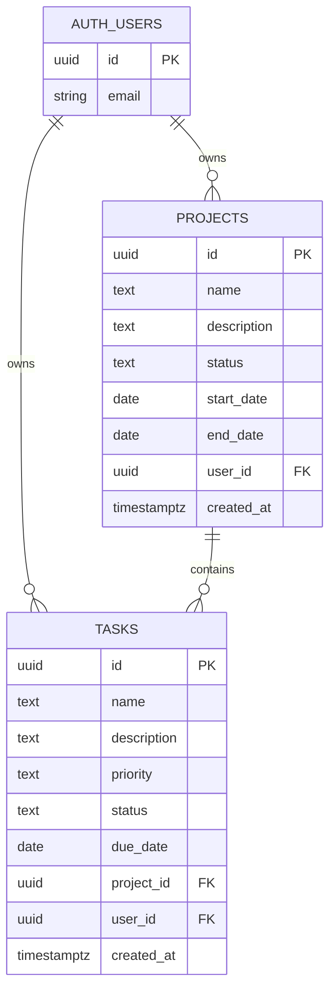

# Database Schema

The schema is defined in [supabase/migrations/20260910095708_create_projects_and_tasks.sql](../supabase/migrations/20260910095708_create_projects_and_tasks.sql).

## Entity Relationship Diagram

`AUTH_USERS` is managed by Supabase Auth and is shown here to document the foreign-key relationships.

## Tables

### `projects`

| Column | Type | Rules |
|---|---|---|
| `id` | `uuid` | Primary key, generated automatically |
| `name` | `text` | Required |
| `description` | `text` | Optional |
| `status` | `text` | `not_started`, `in_progress`, or `completed` |
| `start_date` | `date` | Optional |
| `end_date` | `date` | Optional |
| `user_id` | `uuid` | Required, references `auth.users(id)` |
| `created_at` | `timestamptz` | Required, defaults to `now()` |

### `tasks`

| Column | Type | Rules |
|---|---|---|
| `id` | `uuid` | Primary key, generated automatically |
| `name` | `text` | Required |
| `description` | `text` | Optional |
| `priority` | `text` | `low`, `medium`, or `high` |
| `status` | `text` | `pending`, `in_progress`, or `completed` |
| `due_date` | `date` | Optional |
| `project_id` | `uuid` | Required, references `projects(id)` with cascade delete |
| `user_id` | `uuid` | Required, references `auth.users(id)` |
| `created_at` | `timestamptz` | Required, defaults to `now()` |

## Security

Row Level Security is enabled on both application tables. Every policy is limited to the `authenticated` role and checks `auth.uid() = user_id`:

- Users can select only their own projects and tasks.
- Inserts must belong to the authenticated user.
- Updates require ownership before and after the update.
- Deletes are limited to owned records.
- Deleting a project cascades to its tasks.

## Indexes

- `idx_projects_user_id`
- `idx_tasks_user_id`
- `idx_tasks_project_id`
